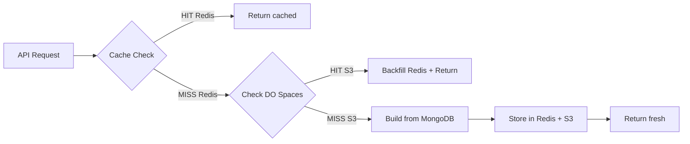

# Redis + DigitalOcean Spaces Cache Integration — Walkthrough

## What Changed

### New File
- **[cache_utils.py](file:///d:/Projects/Dredge/cache_utils.py)** — Shared two-tier cache: Redis L1 (fast, TTL-based) → DO Spaces L2 (persistent S3 storage). Supports [get](file:///d:/Projects/Dredge/cache_utils.py#129-158), [set](file:///d:/Projects/Dredge/cache_utils.py#159-178), [delete](file:///d:/Projects/Dredge/cache_utils.py#179-188), [invalidate_pattern](file:///d:/Projects/Dredge/cache_utils.py#189-230), and async [get_or_build](file:///d:/Projects/Dredge/cache_utils.py#231-256).

### Backend Modules Updated (5 files)

| File | Before | After |
|------|--------|-------|
| [tree_builder.py](file:///d:/Projects/Dredge/mongo_graph/tree_builder.py) | In-memory `defaultdict`, rebuilt every request | Cached in Redis (1h TTL) + DO Spaces, `force_refresh` support |
| [user_tree_builder.py](file:///d:/Projects/Dredge/mongo_graph/user_tree_builder.py) | In-memory [dict](file:///d:/Projects/Dredge/mongo_graph/user_tree_builder.py#64-74), rebuilt every request | Same pattern as above |
| [schema_manager.py (graph)](file:///d:/Projects/Dredge/mongo_graph/schema_manager.py) | Local [schema_cache.json](file:///d:/Projects/Dredge/schema_cache.json) | Redis + DO Spaces (24h TTL) |
| [llm_analyzer.py](file:///d:/Projects/Dredge/mongo_graph/llm_analyzer.py) | Local [field_analysis_cache.json](file:///d:/Projects/Dredge/mongo_graph/field_analysis_cache.json) | Redis + DO Spaces (24h TTL) |
| [schema_manager.py (nlp)](file:///d:/Projects/Dredge/nlp_to_mongo/schema_manager.py) | Local [schema_cache.json](file:///d:/Projects/Dredge/schema_cache.json) | Redis + DO Spaces (24h TTL) |

### API Changes

| Endpoint | Change |
|----------|--------|
| `POST /graph/api/graph` | New `force_refresh` field in request body |
| `POST /graph/api/user-tree` | New `force_refresh` field in request body |
| **`POST /graph/api/cache/clear`** | **New endpoint** — clears cache by target ([sunburst](file:///d:/Projects/Dredge/mongo_graph/tree_builder.py#77-209), `usertree`, [schema](file:///d:/Projects/Dredge/nlp_to_mongo/schema_manager.py#13-27), [llm](file:///d:/Projects/Dredge/mongo_graph/schema_manager.py#57-78), `all`) |

### Frontend Changes

| Page | Change |
|------|--------|
| [GraphViewer.tsx](file:///d:/Projects/Dredge/frontend/src/pages/GraphViewer.tsx) | "🔄 Refresh Cache" buttons next to Build Sunburst and Generate Tree |
| [NlpQuery.tsx](file:///d:/Projects/Dredge/frontend/src/pages/NlpQuery.tsx) | "🔄 Refresh Schema Cache" button in header |

### Config & Deps
- [.env](file:///d:/Projects/Dredge/mongo_graph/.env) files for `mongo_graph` and `nlp_to_mongo` now include Redis + DO Spaces credentials
- [requirements.txt](file:///d:/Projects/Dredge/temp_requirements.txt) for both modules now include `redis` and `boto3`

## How It Works

## To Test
1. Restart services: [.\start_all.bat](file:///d:/Projects/Dredge/start_all.bat)
2. Open Graph Viewer → Build Sunburst (first time: slow, second time: fast from cache)
3. Click "🔄 Refresh Cache" → rebuilds and caches fresh data
4. Open NLP Query → click "🔄 Refresh Schema Cache" → refreshes schema from MongoDB
